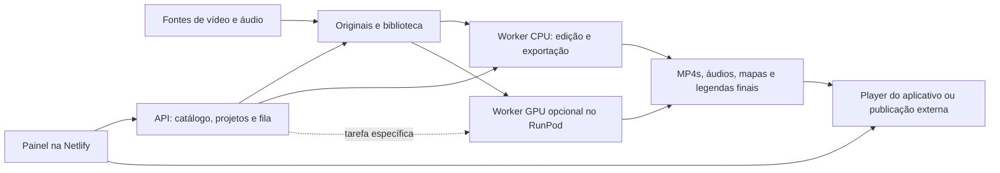

# Slow View TV: gerenciar, editar e assistir

Proposta de produto e arquitetura, 19/10/2026. Este documento separa o que já existe localmente do que ainda será desenvolvido. Não representa atualização do site, compra de infraestrutura ou integração de novos serviços.

## Recomendação

O painel será o estúdio de criação e o gerenciador do catálogo. A interface fica na Netlify. O usuário faz as escolhas no navegador e pede prévias ou exportações; um servidor executa o processamento e devolve o resultado. A Netlify já hospeda o frontend, mas a edição pesada não será executada em suas Functions.

**Decisão do piloto:** reutilizar o RunPod existente para API, banco, arquivos e FFmpeg. Não contratar DigitalOcean ou outro servidor agora. O desligamento desse Pod também interrompe biblioteca e reprodução; a separação entre catálogo permanente e GPU por tarefa ainda não existe. Consulte [o primeiro teste com filmagem real](pilot-real-footage.md).

O produto terá um espaço para quem organiza e edita e outro para quem assiste. O espectador recebe um player simples; não precisa ver tarefas técnicas, fila de processamento ou fornecedores.

No piloto local atual, API, SQLite, fila e arquivos compartilham um servidor. Separar worker e armazenamento é uma evolução: não é uma integração já entregue. Para servir vídeos a espectadores, a recomendação futura é armazenamento de objetos com entrega por CDN. Assim o player continua funcionando quando um worker de processamento é desligado. Discos efêmeros de um Pod não serão a única cópia dos originais ou finais.

## Onde cada parte acontece

| Parte | Papel | Escolha inicial |
| --- | --- | --- |
| Netlify | Entregar as telas de biblioteca, editor, tarefas e player | Manter o frontend existente |
| Navegador | Selecionar cortes, ouvir áudio, ajustar textos e visualizar mapa/player | Editor guiado com prévias |
| API e banco | Guardar materiais, fontes, projetos, versões, direitos e estados das tarefas | Reaproveitar Node/SQLite; uma instância no piloto |
| Worker CPU | Cortes, fades, mixagem, nivelamento, textos e composição do mapa | FFmpeg; custo medido no primeiro vídeo |
| Worker GPU | Eventual restauração, redução de ruído por IA, ampliação ou processamento em escala | Avaliar somente após comparar resultado e custo |
| Armazenamento e entrega | Guardar originais/finais e transmitir os arquivos aos espectadores | Disco persistente no piloto; objetos/CDN antes de disponibilização pública em escala |

RunPod é um fornecedor de máquinas; FFmpeg, um editor visual e modelos de melhoria são as ferramentas que rodam nessas máquinas. Uma GPU pode acelerar ferramentas compatíveis, mas não melhora a imagem automaticamente. Corte, áudio, legenda e mapa podem começar em CPU. O tempo de exportação em 4K e o custo por minuto ainda precisam ser medidos.

Para construir a primeira referência de qualidade, DaVinci Resolve na versão gratuita, Kdenlive e Audacity são alternativas locais, conforme os recursos e o computador disponíveis. Servem para escolhas editoriais e para comparar o resultado automatizado. Só os controles repetíveis e úteis devem virar funcionalidades do painel. O objetivo não é reconstruir um editor profissional inteiro no navegador antes de validar uma filmagem.

## Fontes para começar com baixo custo

Após o acesso funcionar, a publicação **NRK — Bergensbanen**, trazida pelo usuário, e sua licença foram lidas. A pesquisa também encontrou **Nordlandsbanen**, com quatro estações e GPS publicado, e **Flåmsbanen**. Metadados dos torrents oficiais foram recuperados; os vídeos ainda não foram baixados. Consulte [as fontes verificadas e o fluxo de produção](verified-media-sources.md) e [a ficha da Bergensbanen](nrk-bergensbanen.md). Os relatos de bloqueio abaixo registram a fase anterior; para o estado atual de cada destino, use a pesquisa verificada.

A lista abaixo reúne outras fontes candidatas. Não há verificação atual de preços nem seleção de clipes pagos. As fontes NRK e a amostra gratuita Pexels têm evidências próprias nos documentos vinculados; a amostra curta já foi obtida e processada no teste local.

Nesta revisão, as páginas oficiais de licença do Mixkit e de documentação do Freesound também retornaram bloqueio de túnel HTTP 403. Não foi contornada a política de rede. A liberação de fontes já preparada no ambiente Codex precisa ser aplicada antes de verificar os destinos correspondentes; Mixkit/Freesound ainda precisariam ser acrescentados se forem escolhidos para pesquisa dentro deste ambiente. A navegação manual do usuário é independente dessa limitação.

| Fonte | Material e uso inicial | Custo e seleção |
| --- | --- | --- |
| [Pexels Videos](https://www.pexels.com/videos/) | Natureza, paisagens e planos de apoio | Catálogo gratuito, licença própria; conferir [condições](https://www.pexels.com/license/) e uso pretendido de cada arquivo |
| [Pixabay Videos](https://pixabay.com/videos/) e [efeitos sonoros](https://pixabay.com/sound-effects/) | Filmagens e sons ambientes | Opções gratuitas, licença própria; conferir [resumo e termos](https://pixabay.com/service/license-summary/) e eventual material de terceiros |
| [Mixkit](https://mixkit.co/free-stock-video/) | Alternativa para planos específicos | Opções gratuitas; conferir a [licença aplicável ao item](https://mixkit.co/license/), pois as permissões variam |
| [Freesound](https://freesound.org/) | Chuva, vento, água e ambientes gravados | Buscar CC0 ou CC BY quando compatível com o projeto, guardar atribuição e conferir os termos do arquivo; arquivos NC não servem para uma edição comercial |
| Criador original | Viagem longa e contínua, rota documentada, som original | Negociar autorização por escrito e arquivo original; preço depende do acordo |
| [Envato](https://elements.envato.com/stock-video) ou [Storyblocks](https://www.storyblocks.com/video) | Preencher uma necessidade que o catálogo gratuito não resolveu | Comparar plano e licença vigentes só depois de identificar os clipes necessários; não contratar vários bancos de início |

Pesquisas iniciais: [floresta estável](https://www.pexels.com/search/videos/forest/), [mar e ondas](https://www.pexels.com/search/videos/ocean%20waves/), [chuva](https://pixabay.com/videos/search/rain/) e [viagem de trem](https://www.pexels.com/search/videos/train%20journey/). Os links abrem buscas, não são recomendações de clipes já avaliados.

Para uma viagem contínua de 20–60 minutos, planos curtos de bancos podem não atender. Uma gravação longa autorizada pode ser melhor do que repetir poucos segundos de movimento ou juntar locais diferentes. Uma coleção de planos deve ser apresentada como coleção, preservando a localização de cada um. Não representar a montagem como um percurso real contínuo.

O registro mínimo de cada candidato inclui página da fonte, autor, licença e data de consulta, condições de edição/publicação, duração, resolução, presença de áudio e localização comprovada. Conferir em especial se o uso em um vídeo ambiente longo é permitido: acrescentar texto, mapa ou som não garante autorização para redistribuir material quase original nem monetização numa plataforma. YouTube pode fornecer referências e contato com autores; a disponibilidade pública de um vídeo não autoriza sua reutilização.

## O que significa melhorar o vídeo

| Camada | Trabalho editorial proposto | Situação local |
| --- | --- | --- |
| Ritmo e imagem | Escolher cenas estáveis, retirar trechos desconfortáveis, ajustar exposição/cor e estabilizar quando fizer sentido | Corte de um trecho e fades prontos; correção de cor e estabilização ainda pendentes |
| Áudio | Nivelar volume, tratar ruído específico, suavizar emendas, manter som natural ou permitir silêncio | Nivelamento, fades, áudio original/faixa ambiente/silêncio prontos; limpeza de ruído e mixagem com várias camadas ainda pendentes |
| Mapa | Localização ou rota discretas, com opção de ocultar | Ainda não integrado ao novo editor/player |
| Textos e legendas | Nome do lugar, contexto curto, bom contraste, legendas opcionais; transcrever somente quando houver fala relevante | Ainda não integrado ao novo fluxo |
| Reprodução | Play iniciado pelo usuário, volume baixo, pausa simples, tela com poucos elementos e temporizador opcional | Player básico e modo sem distrações prontos localmente |
| Publicação | Revisar, aprovar, disponibilizar ou exportar para outro canal | MP4 e créditos prontos; publicação automática e transmissão contínua pendentes |

Filtros fortes, estabilização excessiva, ampliação artificial e redução de ruído agressiva podem piorar movimento, detalhes e som. Comparar o original e a edição antes de decidir quais tratamentos conservar. A avaliação de conforto depende da pessoa: oferecer opções simples para áudio, mapa e textos; não prometer um efeito clínico.

## Mapa e legendas

O mapa tem dois níveis. Com localização conhecida, mas sem trajeto, mostrar apenas o lugar ou região. Para um marcador móvel, precisamos de uma rota verdadeira e de correspondência entre tempo da filmagem e posição: GPX com horários ou pontos de sincronização conferidos. Um GPX sozinho não sincroniza automaticamente um vídeo. Se o local não puder ser confirmado, o mapa permanece ausente até haver informação suficiente.

No player do aplicativo, mapa e legendas podem ser camadas opcionais, que o espectador liga ou desliga. Em exportações para YouTube ou outros destinos, uma versão pode ter o mapa incorporado à imagem; esse mapa não será interativo. Legendas podem ser entregues em SRT/VTT separado ou incorporadas conforme o destino. Isso precisa constar nas opções da exportação.

Separar texto editorial (lugar, horário confirmado, contexto) de legenda do áudio (fala ou informação sonora relevante). Usar frases curtas, área segura da imagem, contraste estável e poucas entradas. Créditos completos ficam na ficha e no arquivo de créditos, para evitar informação contínua cobrindo a paisagem.

## Organização do dashboard

1. **Biblioteca:** originais de vídeo e áudio, miniaturas, fonte, direitos, local, duração, resolução e avaliação editorial.
2. **Projetos:** versão em edição com trechos, áudio, mapa, textos, legendas e comparação de prévias. Preservar o original e guardar uma nova versão a cada revisão relevante.
3. **Processamento:** fila, progresso, erro, cancelamento e resultado. Distinguir material exportado de material aprovado ou publicado.
4. **Catálogo:** vídeos aprovados, coleções, tags, destino e versões de qualidade. Publicar deve ser uma ação explícita.
5. **Assistir:** player separado da área técnica, com preferências claras de áudio/mapa/texto e nenhuma sequência iniciada sozinha.

Fluxo sugerido: encontrado → direitos conferidos → importado → em edição → exportado → revisado/aprovado → publicado. Um projeto pode ter várias versões sem baixar o original outra vez.

“Rodando” precisa ter significado explícito. Na fila significa um arquivo em processamento. No aplicativo significa a sessão de um espectador — vários usuários podem estar vendo vídeos diferentes. Numa transmissão contínua significa uma programação/playlist com um processo de reprodução que deve continuar ligado. São estados diferentes e não devem compartilhar um indicador fictício de “ao vivo”. Um canal contínuo exigirá operação, monitoramento e destino de transmissão próprios, além deste editor.

## Primeiro ciclo de implementação

1. Encontrar três candidatos reais gratuitos ou negociáveis e guardar fonte/condições, sem assinar um banco antes de encontrar uma necessidade concreta.
2. Escolher um único trecho de 60–90 segundos com boa imagem e som, e localização verificável se quisermos avaliar o mapa. Se não houver localização confiável, avaliar primeiro imagem/áudio/texto.
3. Produzir uma versão de referência: ritmo, áudio, cor, identificação discreta e mapa quando houver dados. Comparar original e resultado com o usuário.
4. Acrescentar ao painel os controles usados nessa versão, mais prévia e histórico. O editor atual de um trecho é a base; mapas, legendas, montagem de vários clipes e restauração não foram entregues ainda.
5. Medir tempo de processamento, tamanho de arquivo e custo de armazenamento/entrega. Só então decidir a hospedagem CPU e se alguma tarefa justifica GPU por demanda.
6. Atualizar backend e frontend de forma coordenada. O site atual continua na versão anterior; esta proposta e a implementação local não alteram o RunPod nem a Netlify.

Orçamento editorial inicial pode ser zero usando candidatos gratuitos aprovados. Hospedagem, armazenamento e tráfego têm custos separados e dependem do uso. Não há valor mensal ou custo por vídeo validado nesta etapa.
