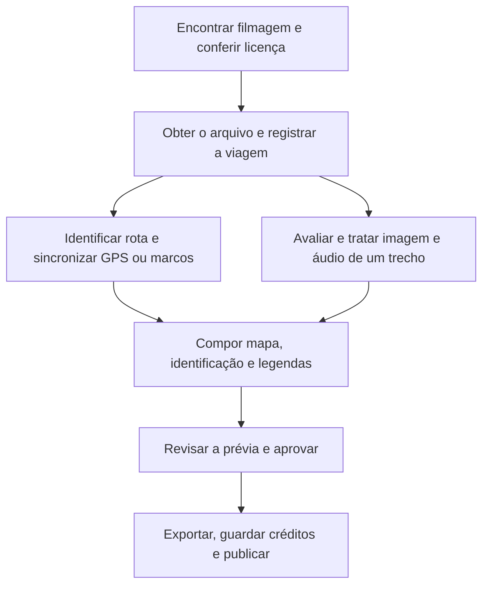

# Fontes verificadas e fluxo de produção

Pesquisa em 19/10/2026. Este documento registra leituras reais e distingue páginas consultadas, metadados recuperados e vídeos efetivamente baixados. Não houve compra, contato com criadores, transferência das viagens completas NRK ou atualização do site. Um clipe curto Pexels foi obtido para o primeiro teste, conforme descrito abaixo.

## Resultado da pesquisa

NRKbeta, Creative Commons e a licença do Pexels responderam HTTP 200. A NRK tem outros materiais concretos além da Bergensbanen: **Nordlandsbanen** e **Flåmsbanen**. Os três têm publicações oficiais descrevendo reutilização, com diferenças nas versões das licenças e nos créditos. Foram recuperados e decodificados os três arquivos `.torrent` atuais. Isso confirma os metadados publicados, mas não a disponibilidade dos peers ou o conteúdo dos arquivos de vídeo.

### Nordlandsbanen: alternativa com quatro estações e GPS

- [Artigo oficial em inglês](https://nrkbeta.no/2013/01/15/nordlandsbanen-minute-by-minute-season-by-season/): Trondheim → Bodø, aproximadamente dez horas, 729 km, quatro gravações — inverno, primavera, verão e outono.
- [Publicação oficial de download](https://nrkbeta.no/2012/12/29/konkurrer-og-last-ned-den-synkrone-nordlandsbanen-minutt-for-minutt/): declara **CC BY-SA 3.0** para os arquivos sincronizados. O artigo em inglês também tem uma licença própria para seu texto/fotografias; não confundir a licença do artigo com a dos vídeos.
- O artigo identifica locomotivas **NSB Di. 4** e câmera frontal Sony XDCAM. A identificação do material rodante vem da publicação, não de inferência a partir da imagem.
- As posições foram registradas por GPS a 1 Hz em cada viagem. O verão foi escolhido como referência e as outras estações sofreram remapeamento temporal para coincidir com ele. O artigo afirma disponibilizar os dados GPS.
- Em comentário de 09/01/2014 no mesmo artigo, **Jon Ståle Carlsen (NRK)** fornece um CSV com segundos desde o início e coordenadas a cada dez segundos, e orienta a encontrar o deslocamento temporal usando o verão como referência. [Link publicado para o CSV](https://www.dropbox.com/s/wmao8c0f0zqjxtg/nordlandsbanen_time_pos.csv). Esse arquivo ainda não foi obtido: houve bloqueio inicial HTTP 403 e uma consulta posterior devolveu HTTP 200 com página HTML de erro do Dropbox, não um CSV.
- [Torrent oficial atual de verão](https://nrkbeta.no/torrent/nordlandsbanen.summer.sync.1920x1080.h264.nrk.mp4.torrent): HTTP 200; nome `nordlandsbanen.summer.sync.1920x1080.h264.nrk.mp4`; tamanho **18.348.031.008 bytes** (18,348 GB decimais); info hash `50643c1fd71ff5d3dba8ceb24fef4b7feaac3abc`.
- O traçado e o relógio do arquivo recebido precisam ser comparados com o GPS e com marcos visuais. Ter um link de GPS não comprova uma sincronização já pronta no nosso sistema. Não interpolar posições através de falhas sem informar/revisar.

**Interesse para o produto:** quatro atmosferas reais e dados geográficos da própria gravação podem reduzir o trabalho de identificação e melhorar a confiabilidade do mapa. Não há ainda um vídeo importado ou um mapa validado na aplicação.

### Flåmsbanen: outro trajeto completo

- [Publicação oficial](https://nrkbeta.no/2010/09/03/last-ned-flaamsbana-i-2d-og-3d/): viagem de **Myrdal → Flåm**, do alto da montanha até o fiorde. Oferece versões 2D em 720p/1080p e alternativas estereoscópicas.
- A atualização de licença do próprio artigo explicita uso privado/comercial e aponta **[CC BY-SA 3.0 Noruega](https://creativecommons.org/licenses/by-sa/3.0/no/)**. Essa página da licença norueguesa não foi consultada separadamente nesta rodada; a versão foi lida no texto da emissora.
- Creditar NRK e seguir os links/condições indicados na publicação, inclusive o compartilhamento da adaptação. Não copiar automaticamente o crédito da Bergensbanen para outro título.
- [Torrent oficial atual 2D Full HD](https://nrkbeta.no/torrent/Flamsbanen.hele.turen.1920x1080.h264.NRK.torrent): HTTP 200; nome `flamsbanen.hele.turen.1920x1080.h264.Nrk.mp4`; tamanho **3.763.728.590 bytes** (3,764 GB decimais); info hash `218fafb2d888ad44e217f13e96c722bf4fd83920`.
- O vídeo completo, duração real, som, trem e pontos de sincronização ainda não foram inspecionados. A versão 2D é o candidato inicial; não é necessário equipamento de exibição 3D.

**Interesse para o produto:** outra viagem identificada e um arquivo menor para um primeiro ensaio de ingestão. Não tratar o simples download do `.torrent` como obtenção da filmagem.

### Bergensbanen: fonte trazida pelo usuário

- [Artigo oficial](https://nrkbeta.no/2009/12/18/bergensbanen-eng/): Bergen → Oslo, câmera frontal limpa, cerca de sete horas; retirada de música/clipes com outros direitos.
- Licença consultada: [CC BY-SA 3.0 Unported](https://creativecommons.org/licenses/by-sa/3.0/), com crédito específico exigido pela emissora ao final e na descrição.
- O link antigo do artigo retornou 404, mas o [índice atual](https://nrkbeta.no/bittorrent/) contém um `.torrent` funcional para o arquivo de **23,179 GB decimais**, segundo seus metadados.
- Veja [a ficha completa](nrk-bergensbanen.md). O ProRes de 246 GB mencionado pela NRK não é necessário para a primeira avaliação.

### Pexels: primeira amostra real obtida

A [página oficial de licença](https://www.pexels.com/license/) foi lida com HTTP 200. Ela permite uso gratuito e modificações, dispensa atribuição em seus termos gerais e descreve restrições, incluindo venda de cópias sem alterações, endosso e redistribuição em outros bancos de imagens. Isso não aprova automaticamente qualquer clipe para qualquer finalidade ou cria uma rota geográfica verificada.

Foi consultada a página individual de [trem na neve em Himachal Pradesh, de shalender kumar](https://www.pexels.com/video/a-train-travelling-through-the-railroad-in-the-snowy-mountain-of-himachal-in-india-3563086/) e obtido do CDN oficial um arquivo de 10,06 MB. FFprobe confirmou 25,92 s, 720p, 25 fps progressivos e áudio AAC estéreo. A localização é informada pela fonte; percurso e trem não foram confirmados. Há uma versão 4K oferecida pelo autor; o teste inicial usa 720p. Veja [material, hash, teste e implantação](pilot-real-footage.md).

O conector de busca Pexels existe localmente, mas a chave está ausente. Ele não pesquisa NRK nem bancos pagos. A amostra usa um link direto oficial, sem chave e sem pesquisa automática em massa.

### Hurtigruten: referência adicional, ainda sem aprovação completa

Foi lida a [publicação de 2011 sobre a distribuição Full HD](https://nrkbeta.no/2011/12/21/hurtigrutenbonanza-splitterny-full-hd-nedlasting-bittorrent-hele-sendingen/). Ela descreve 134h42m45s, uma mixagem sem a música protegida da transmissão e 161 partes, totalizando cerca de 555 GB. Esse artigo foi consultado, mas a licença específica e os arquivos não foram integralmente verificados nesta rodada. Não classificar este candidato com o mesmo grau de aprovação dos três acima nem iniciar a transferência desse volume para o piloto.

## Opções pagas a comparar

As páginas abaixo foram consultadas, mas todas retornaram bloqueio de túnel HTTP 403. Seus preços e condições atuais **não foram verificados**. São candidatos comerciais, não recomendações de clipes já avaliados ou compras aprovadas.

| Fornecedor | Modelo de aquisição a investigar | Uso possível no projeto |
| --- | --- | --- |
| [Pond5](https://www.pond5.com/stock-footage/1/train-driver-view.html) | Licenciamento de clipes, inclusive compra avulsa conforme oferta | Procurar filmagem de cabine com origem e destino demonstráveis; comparar duração e preço do material exato |
| [Shutterstock](https://www.shutterstock.com/pricing/video) | Licenciamento de vídeo por oferta/plano | Cenas específicas e material de apoio; confirmar a adequação do uso em vídeo ambiente longo |
| [Storyblocks](https://www.storyblocks.com/pricing) | Biblioteca por assinatura | Volume de cenas de natureza ou apoio quando houver uma necessidade recorrente |
| [Artgrid](https://artgrid.io/stock-footage) / [Artlist](https://artlist.io/) | Biblioteca de filmagens e planos do fornecedor | Pesquisar coleções coerentes e comparar a licença para o destino pretendido |
| [Envato Elements](https://elements.envato.com/pricing) | Assinatura de recursos audiovisuais | Filmagens, grafismos e outros recursos quando compatíveis com a licença da edição |

Para uma viagem contínua longa, verificar também a possibilidade de licenciar o original diretamente com um criador. Um download vendido para assistir ou um DVD de viagem não concede automaticamente direitos de edição e publicação. Não houve contato com fornecedores ou criadores.

Antes de comparar assinaturas, localizar o arquivo que realmente atende à necessidade. Registrar: duração, resolução, movimento da câmera, origem/destino, possibilidade de obter GPS ou lista de estações, som disponível, licença para o formato final e custo total. Clipes curtos não se tornam uma viagem contínua verdadeira por serem pagos.

Ao adaptar NRK sob BY-SA, verificar a compatibilidade de qualquer música, áudio, mapa ou recurso incorporado. O pagamento por um recurso não torna sua licença compatível com redistribuição sob BY-SA. Para o primeiro piloto, som original ou recurso CC0 pode simplificar essa parte; isso ainda depende da inspeção do arquivo.

## As fontes antigas e seu papel na filmagem real

| Fonte/integração anteriormente mapeada | O que fornece | Papel agora |
| --- | --- | --- |
| OpenStreetMap + Overpass | Geometria de trilhos, estações e objetos mapeados | Preparar/conferir o traçado e rótulos do mapa; não identifica sozinho onde cada quadro foi filmado |
| OpenRailwayMap | Visualização da infraestrutura ferroviária baseada em OSM | Referência de revisão e possível camada de mapa, com atribuição e condições próprias |
| Dados oficiais, operadoras e GTFS | Serviços, nomes de paradas, sequências e horários quando disponíveis | Conferir nomes e itinerário; o horário atual não sincroniza uma filmagem antiga |
| Natural Earth | Mapa-base simplificado, já local | Contextualizar país/região no mapa geral |
| Copernicus DEM | Elevação da superfície | Opcional: perfil de altitude ou relevo do mapa; não restaura detalhes dos pixels de um vídeo |
| ESA WorldCover | Classes amplas de cobertura do solo | Contexto ou projeto 3D futuro; dispensável para corrigir imagem/áudio de uma gravação real |
| Cesium / Unreal | Globo, dados geográficos e renderização 3D | Possível animação geográfica separada; não é necessário para o piloto com filmagem real |
| Google Earth Studio | Animações geográficas, sujeitas aos termos | Referência opcional, ainda sem aprovação de uso nem integração |
| Áudio próprio/licenciado | Material sonoro | Melhorar o resultado se adequado à cena e à licença; não confundir biblioteca de áudio com ferramenta de limpeza |

As integrações antigas estavam em graus diferentes de implementação. OSM/Overpass e a camada OpenRailwayMap foram preparados para o protótipo; não há uma rota NRK validada por eles hoje. DEM, WorldCover, GTFS e os motores 3D não foram integrados ao novo editor.

## Quem faz cada trabalho

**O programa de processamento será uma peça do nosso sistema.** O usuário opera o painel; não precisa usar um terminal ou transportar manualmente todo projeto entre vários sites.

- **Netlify:** hospeda as telas de biblioteca, edição, fila e player. É onde o usuário escolhe o material, os cortes e as opções e revisa o resultado.
- **API e banco do sistema:** armazenam fontes, licenças, viagens, projetos, marcos e estados das tarefas; recebem os comandos do painel.
- **Módulo de viagem:** importa metadata/GPS e associa tempo à rota; usa dados oficiais/OSM quando necessário. Curadoria e revisão inicial continuam necessárias. Esse módulo completo ainda será implementado.
- **FFmpeg:** software de processamento multimídia, não uma nuvem. Corta, converte, filtra, combina áudio e compõe imagem, mapa e textos quando programado. O backend já o utiliza para o fluxo local básico.
- **DigitalOcean ou RunPod:** fornecedores dos computadores onde API e ferramentas podem rodar. DigitalOcean foi uma opção de hospedagem CPU discutida; o Pod RunPod existente foi usado no piloto 3D. Nenhum novo serviço CPU foi criado.
- **Ferramentas especializadas:** editor visual ou modelos podem ajudar a definir cor, limpeza ou restauração. Não são uma assinatura obrigatória para o fluxo básico. As operações aprovadas podem ser chamadas pelo nosso backend quando houver integração.
- **Armazenamento e entrega:** mantêm os originais/finais e servem o vídeo ao player. O piloto atual usa disco do backend; separar entrega e processamento ainda é trabalho futuro.

## Fluxo e dependências

Identificar origem/destino ocorre cedo para evitar prometer um percurso errado. Depois, sincronização do mapa e tratamento audiovisual podem avançar em paralelo. O mapa móvel da exportação depende de uma relação tempo/posição validada. Melhorar o áudio não exige esperar que toda a rota esteja pronta.

Para Nordlandsbanen, o caminho pretendido é importar o GPS publicado e validar deslocamento temporal e sentido, conferir o trem e a rota na documentação, testar um trecho, depois gerar abertura, mapa e legendas a partir da mesma ficha. O sistema não foi implementado para deduzir qualquer percurso apenas assistindo a qualquer vídeo.

## Próximo trabalho concreto e limites

1. Obter o GPS do verão e validar a relação com o arquivo sincronizado. O link Dropbox ainda não entregou o CSV; não confundir sua página de erro HTTP 200 com o arquivo.
2. Verificar a viabilidade de transferência autorizada de um dos vídeos publicados. Os metadados apontam trackers HTTP, inclusive porta 16969, sem webseed nos três torrents inspecionados. Não há verificação de peers nem suporte P2P no aplicativo/ambiente estabelecido nesta pesquisa. Não contornar as restrições de rede.
3. Preparar ingestão própria e armazenamento para originais grandes; o atual importador HTTP de Pexels/Pixabay e o limite padrão de 512 MB não atendem esses arquivos NRK.
4. Representar BY-SA e créditos específicos na biblioteca e incluir marcos geográficos. A cadência já deixou de ser forçada para 30 fps; a verificação do arquivo NRK efetivo e do entrelaçamento continua pendente.
5. Produzir e revisar uma primeira amostra curta antes de renderizar horas ou adquirir um plano pago.

O salvamento dos destinos de bancos pagos e Dropbox no rascunho de rede não confirmou acesso a eles; as tentativas desta revisão receberam 403. A ferramenta informa que o rascunho requer revisão/salvamento/publicação para ativação. NRKbeta/Pexels/Creative Commons já responderam na prática, apesar do status de rede genérico ainda não refletir essas observações. Não descrever todo acesso como bloqueado ou como irrestrito a partir de um único indicador.
